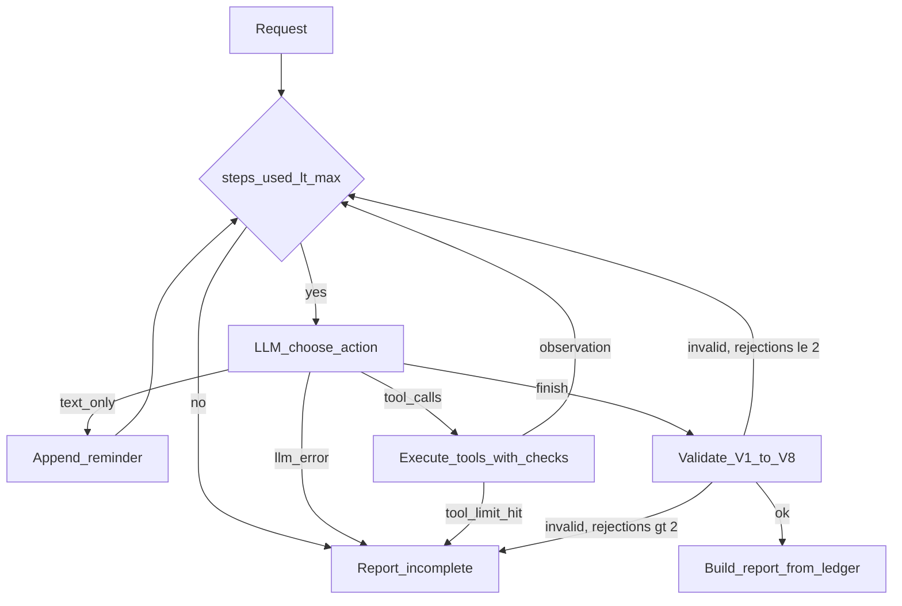

# 02 方案

## 总体流程

核心循环在 `src/agent.py::run_once`：每一步调用一次模型，模型返回 tool_calls；循环执行工具、把结果作为 tool 消息回填，再由模型决定下一步，直到模型调用 `finish` 并通过校验，或达到上限。

## 工具

| 工具 | 作用 | 关键行为 |
|---|---|---|
| `get_material` | 素材读取 | 返回原始数据叠加补查结果，缺失字段为 null |
| `lookup_material_supplement` | 补查 | 查到的字段写入会话叠加层，后续 `check_rules` 可见 |
| `check_rules` | 规则检查 | R001 缺失字段 / R002 禁用词 -> high / R003 版权 pending -> medium / R004 广告类未带广告标识 -> high |
| `query_slots` | 时段查询 | 占用 = 排期表 + 其他素材的有效草稿；替代时间按小时差升序、同差取晚，最多 3 个 |
| `save_schedule_draft` | 排期草稿保存 | 8 步校验后写入；幂等；替换旧草稿；原子写 |
| `finish` | 结束 | 提交每个素材的结论，经 V1-V8 校验 |

每个业务工具都有必填参数 `reason`（一句话决策依据），执行前剥离，只写入 trace，用于满足“记录简要决策依据”且不需要提交模型内部思考过程。

## 模型决策点与代码校验点

**模型决定**（system prompt 给出业务规则，见 `src/prompts.py`）：

- 是否补查、补查哪些字段；补查后是否重新检查
- 冲突时选哪个替代时间，或在硬性时间冲突时不保存、请用户决定
- 是阻断、标记信息缺失、请求确认还是通过
- 保存失败后是否重试；何时结束

**代码保证**（不依赖模型自觉）：

保存前按顺序校验，第一个不通过即返回错误码（`src/tools.py::_t_save_schedule_draft`）：

1. 参数与素材是否在请求中 -> `invalid_arguments`
2. 本次会话已成功执行 `check_rules`，且最近一次无缺失、非高风险 -> 否则 `precondition_failed`
3. 时间在可排时段内 -> `slot_out_of_range`
4. `time_hard` 时不得改时间 -> `hard_constraint_violation`
5. 中风险或改了时间时必须有待确认项 -> `confirmation_required`
6. 时段未被占用 -> `slot_conflict`
7. 故障注入 -> `tool_unavailable`
8. 写入：同素材同时段已有有效草稿则原地更新（`duplicate=true`）；否则新建并把旧有效草稿标为 `superseded`

结束时 `finish` 校验（`src/guardrails.py::validate_finish`）：

| 规则 | 内容 |
|---|---|
| V1 | 请求中每个素材恰好出现一次 |
| V2 | `approved` 须无风险、字段完整、建议时间=请求时间、无待确认项 |
| V3 | `needs_confirmation` 须有待确认项 |
| V4 | `info_missing` 须有缺失字段或 not_found 证据 |
| V5 | 硬性时间时，建议时间只能为空或请求时间 |
| V6 | 给出建议时间时，最后一次保存须为该时间且成功或 `tool_unavailable` |
| V7 | `blocked` / `info_missing` 不得有成功保存 |
| V8 | 文本不得出现“已发布 / 发布成功”（允许“未发布”等否定） |

不通过则把错误列表回填给模型修正，最多打回 2 次。

**报告由代码组装**（`build_report`）：风险、缺失字段来自最近一次 `check_rules`；草稿状态来自最后一次保存尝试；`slot_changed` 由代码计算；`publish_status` 固定 `not_published`。模型只提供结论、建议时间、待确认项和理由，因此即使模型在文字中声称“保存成功”，报告中的草稿状态仍以账本为准（见 `tests/test_agent_scripted.py::test_false_save_claim_is_overridden_by_ledger`）。

## 结论优先级

`blocked > info_missing > needs_confirmation > approved`。

保存失败：prompt 规定重试后仍失败时结论为 `needs_confirmation`，保留最后尝试的时间并在待确认项中写明需重试保存（这条规则来自 prompt 对比实验，见 [03-evaluation.md](03-evaluation.md)）。无论模型给出什么结论，报告中 `draft.status=failed`，并归入 `summary.save_failed`。

## 执行上限

- `max_steps`（默认 20）：模型调用次数，包含提醒后的调用
- `max_tool_calls`（默认 40）：非 finish 的工具调用次数（含参数错误、未知工具）
- `finish` 打回超过 2 次

任一触发即返回 `run_status=incomplete` 与 `incomplete_reason`（`max_steps_exceeded` / `max_tool_calls_exceeded` / `finish_rejected` / `llm_error`），所有素材标为 `incomplete`，已有事实（风险、草稿）照常从账本输出。同一轮的并行 tool_calls 在达到上限后，剩余调用回填 `skipped`，保证每个 tool_call_id 都有响应。

## 技术取舍

- **原生实现而非框架**：核心价值在“工具层校验 + 结束校验 + 账本组装报告”，用原生循环约 200 行即可完整控制计数、并行调用回填与打回逻辑，评审也能直接读懂；引入 LangGraph 等框架对本题收益不大。
- **报告由代码组装**：减少模型需要输出的结构化内容，避免谎报保存成功或误报风险；代价是模型的“理由”与代码事实可能存在表述差异，报告同时保留两者。
- **幂等键 `material_id|channel|date|time`**：真实模型两次措辞不同时，待确认项文字会变化，若把文字纳入键会产生多份草稿；按时段为键并原地更新文字，保证“相同请求只产生一份草稿”。换时段时新建并替换，保证每个素材任何时刻只有一份有效草稿。
- **故障注入只作用于保存**：覆盖“保存失败”与“工具失败”验收点，避免其他工具失败带出未定义的结论分支。
- **JSON 文件存储**：满足离线复现；不支持并发写。

## 运行依赖

| 依赖 | 版本 | 用途 |
|---|---|---|
| openai | 3.42.1 | OpenAI 兼容 Chat Completions + function calling |
| python-dotenv | 1.2.4 | 读取 `.env` |
| pytest | 9.2.0 | 测试 |
